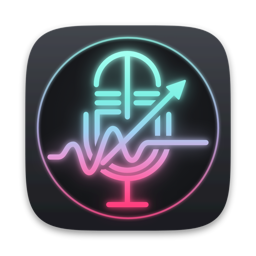
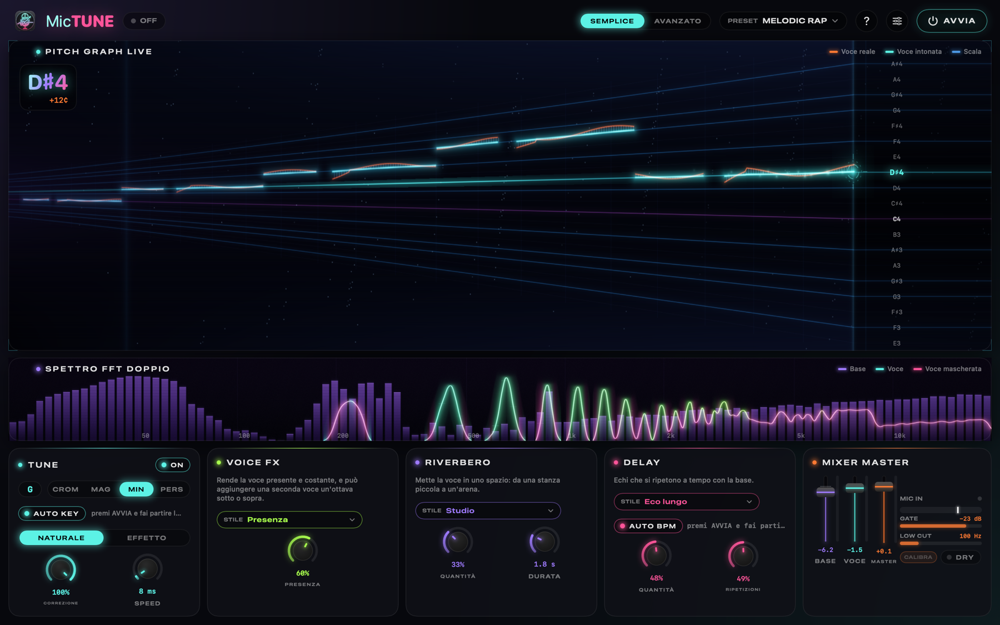
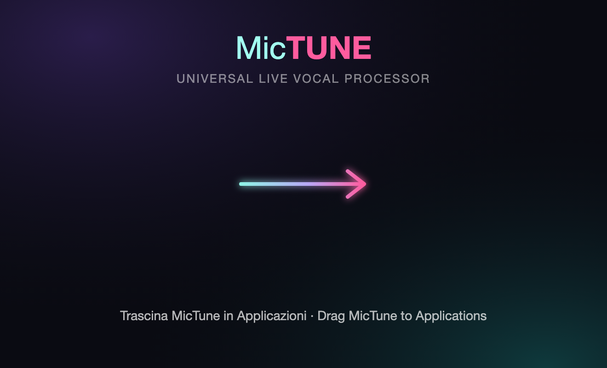
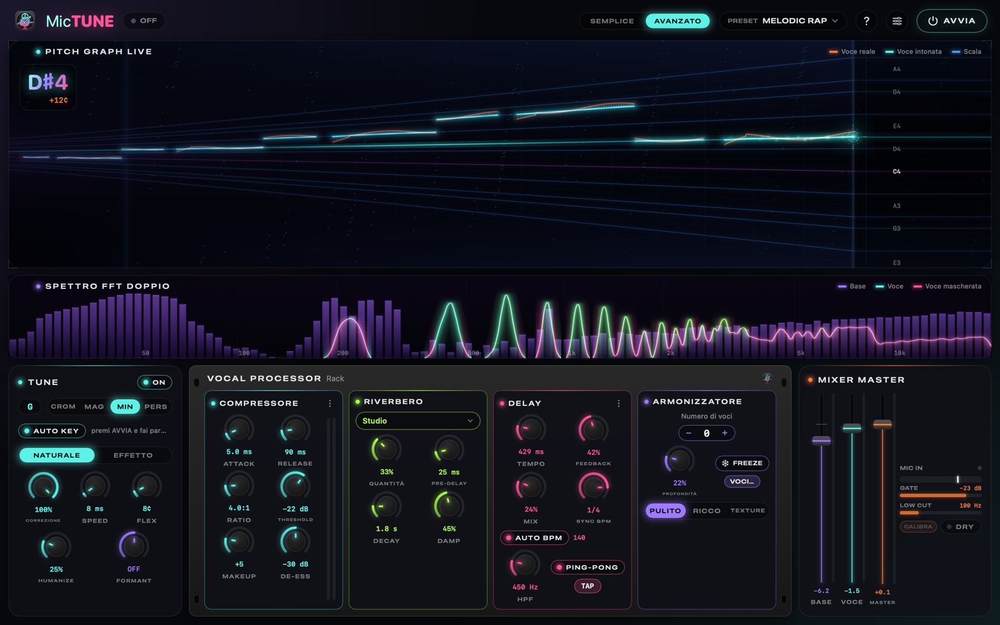
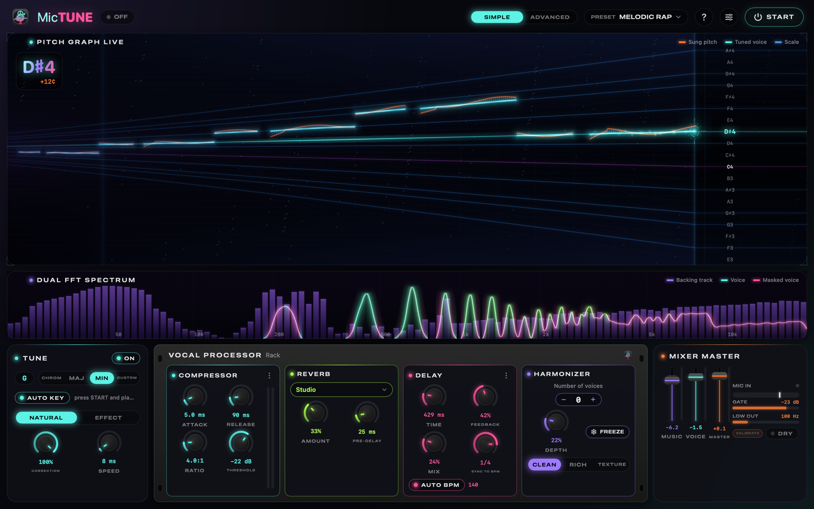
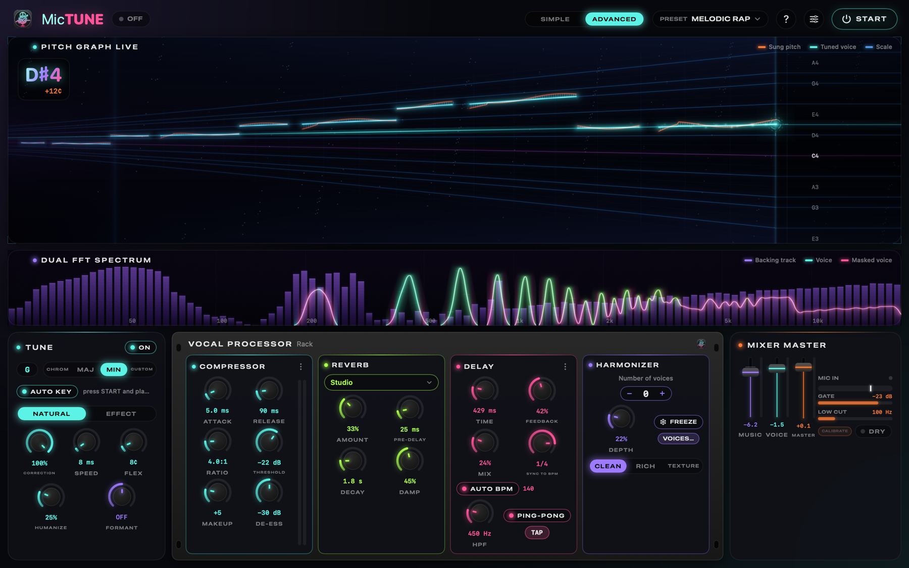

  

<h1 align="center">MicTune</h1>

<b>Universal Live Vocal Processor</b> · correzione dell'intonazione dal vivo per macOS, Windows e Linux

  <a href="https://github.com/kikoz85/mictune/releases/latest"><b>⬇︎ Scarica l'ultima versione / Download the latest version</b></a>

  
  

  <a href="#-italiano">🇮🇹 Italiano</a> · <a href="#-english">🇬🇧 English</a>

---

## 🇮🇹 Italiano

MicTune trasforma il tuo Mac in un processore vocale per cantare dal vivo: **correzione dell'intonazione in tempo reale**, effetti da studio (riverbero, delay, compressione, armonie) e la **base presa direttamente da YouTube, Spotify o VLC**, tutto a latenza bassissima.

### Cosa fa

- 🎤 **Correzione NATURALE** (intona senza suono robotico, mantiene il vibrato) oppure **EFFETTO** (l'hard-tune trap).
- 🎼 **AUTO KEY**: riconosce da solo la tonalità della canzone.
- 🎹 **Correzione guidata da MIDI**: invia la melodia come note MIDI alla porta **MicTune MIDI In** (da Vocalis, Logic, Ableton o una tastiera) e la voce viene intonata sulle note esatte del brano, con 0 ms di latenza aggiunta.
- 🎤 **Cori dal MIDI**: se il brano ha una traccia coro, le armonie cantano le sue note con la tua voce, solo dove il brano ha i cori. Con **Vocalis** (Vocalis Link) canali, tonalità e BPM arrivano da soli.
- 🥁 **AUTO BPM**: riconosce il tempo e mette gli echi a tempo.
- ✨ **Preset** pronti in due famiglie: **correzione naturale** (Melodic Rap, Urban Pop, Indie Pop, Ballad Arena…) e **hard tune** (Trap Hardcore, Dark Trap, Ambient Trap…).
- 🎛️ **Rack Vocal Processor**: compressore, riverbero, delay e **armonizzatore a 4 voci** che segue la tonalità e mantiene il timbro della voce, con **FREEZE** (tiene una nota come tappeto) e **carattere** Pulito / Ricco / Texture.
- 🎚️ Modalità **SEMPLICE** (controlli essenziali e stili pronti) e **AVANZATA** (tutti i parametri).
- 🎧 Uscita su cuffie e impianto insieme, **pulizia del microfono** (gate) e spettri animati.
- 🌍 Italiano, English, Français, Deutsch, Español.
- 🔄 **Aggiornamenti automatici**.

### Requisiti

- Mac con chip **Apple Silicon** (M1, M2, M3, M4…) e **macOS 15** o successivo
- Un **microfono** (scheda audio, mixer USB, microfono USB, webcam o il microfono del Mac)
- **Cuffie con filo** (consigliate)

### Installazione

1. Scarica **MicTune-x.y.z.dmg** dalla pagina [Releases](https://github.com/kikoz85/mictune/releases/latest).
2. Apri il DMG e **trascina MicTune nella cartella Applicazioni**.

   
3. Apri MicTune da Applicazioni. Al **primo avvio** macOS potrebbe dire che non può verificare lo sviluppatore:
   apri **Impostazioni di Sistema › Privacy e sicurezza**, scorri in basso e premi **Apri comunque**, poi conferma.
4. Premi **AVVIA**: macOS chiede il permesso per il **Microfono** e per la **Registrazione audio** (serve per catturare la base). Consenti entrambi.

### Windows e Linux

Stessa app, stesso suono e stessa grafica del Mac.

- **Windows 10 (2004) o 11, 64 bit**: scarica **MicTune-x.y.z-Windows-Setup.exe** e avvialo. Se compare *"Windows ha protetto il PC"*, premi **Ulteriori informazioni › Esegui comunque** (l'installer non ha ancora una firma digitale). Si installa per il tuo utente, senza password di amministratore.
  - La base viene catturata da tutte le app (YouTube, Spotify, VLC, Vocalis) e continua a suonare dall'app stessa: MicTune la usa per AUTO KEY, AUTO BPM e lo spettro.
  - Per la guida MIDI da Vocalis crea con **loopMIDI** una porta chiamata **MicTune MIDI In**.
- **Linux 64 bit con PipeWire** (Debian 13, Ubuntu 25.04 o più recenti): scarica **MicTune-x.y.z-x86_64.AppImage**, rendilo eseguibile (*Proprietà › Consenti l'esecuzione*, oppure `chmod +x`) e aprilo.
  - Mentre MicTune è attivo l'uscita predefinita diventa **MicTune Music**: le app suonano attraverso MicTune, come sul Mac.
  - La porta **MicTune MIDI In** compare da sola: Vocalis la trova senza configurare niente.

### Come collegare le periferiche (importante)

Per avere una correzione pulita servono tre cose: **il microfono deve arrivare a MicTune**, **chi canta deve sentirsi in cuffia** e **la voce non elaborata non deve arrivare alle casse**. Scegli la tua situazione:

#### A · Solo il Mac (MacBook, iMac)
- Microfono: quello integrato del Mac (o una webcam/microfono USB).
- Ascolto: **cuffie con filo** nel jack del Mac.
- ⚠️ **Mai con gli altoparlanti del Mac**: il microfono riprende la voce e la base e si crea feedback (MicTune ti avvisa con un messaggio arancione).

#### B · Microfono USB (es. Shure MV7, Rode NT-USB, Blue Yeti)
- Collega il microfono via USB e le cuffie al jack del Mac (o al jack del microfono, se ce l'ha).
- In **Impostazioni › Audio e mixer**: Ingresso = il microfono USB; Uscite = cuffie.

#### C · Scheda audio (es. Focusrite Scarlett, Audient, MOTU, Universal Audio)
- Microfono nell'ingresso 1 della scheda (accendi la phantom +48V solo per i microfoni a condensatore).
- **Spegni il "Direct monitor"** della scheda: altrimenti in cuffia senti anche la voce pulita, non corretta.
- Cuffie nella scheda; casse (se le usi) alle uscite della scheda.
- In MicTune: Ingresso = la scheda, **Ch 1**; Uscite = la scheda.

#### D · Mixer con USB (es. Yamaha MG-XU, Behringer XENYX USB, Soundcraft Notepad)
Questi mixer mandano al Mac **tutto il loro mix stereo**, quindi va instradato bene:

| Sul mixer | Impostazione |
|---|---|
| Canale del microfono | inviato al mix **ST** (così arriva al Mac) |
| Canale del ritorno USB (es. 11/12 "USB") | **ST spento**, inviato al **GROUP 1-2** (così non rientra nel Mac) |
| Casse / impianto | collegate al **GROUP OUT** (non al master ST) |
| Master ST | a 0 dB (alimenta l'USB verso il Mac) |
| Cuffie di chi canta | nel **jack del Mac** (le PHONES del mixer ascoltano la voce pulita) |

In MicTune: Ingresso = il mixer, **Ch 1** (o Ch 1+2); Uscite = il mixer + l'uscita del Mac per le cuffie.

> Il pulsante **Configura automaticamente** (Impostazioni › Audio e mixer) sceglie da solo la combinazione migliore tra i dispositivi collegati.

#### Da evitare
- **Cuffie o casse Bluetooth** (AirPods ecc.): aggiungono 100–200 ms di ritardo e, se usi il loro microfono, la qualità crolla.
- Ascoltare la propria voce "dal vivo" nella stanza o dalle cuffie del mixer: coprirebbe quella corretta.

### La base musicale

Non serve nessun cavo né programma in più: fai partire la canzone su **YouTube, Spotify, VLC** o qualsiasi altra app. MicTune la cattura, la mixa con la voce e la manda alle tue uscite. Puoi scegliere "Tutto l'audio di sistema" o una sola app in **Impostazioni › Audio e mixer**. Il volume della base si regola col fader **BASE**.

### Primi passi

1. Premi **AVVIA** (o la barra spaziatrice).
2. Fai partire la canzone.
3. Scegli un **PRESET**, ad esempio **MELODIC RAP**: imposta voce, riverbero, delay e attiva **AUTO KEY** e **AUTO BPM**.
4. Se senti la correzione anche sulla base, premi **CALIBRA** nella card MIXER e resta in silenzio 3 secondi.
5. Canta. 🎤

### Armonie e FREEZE

Nel modulo **ARMONIZZATORE** del rack scegli quante voci aggiungere (fino a 4) con − / +: seguono la tonalità della canzone e suonano come cori veri. **FREEZE** (tasto F) tiene la nota che stai cantando come tappeto. Le armonie arrivano pochi millisecondi dopo la voce, come un coro: **la tua voce resta a latenza quasi zero**.

### Correzione guidata da MIDI

Nel player o nella DAW scegli l'uscita MIDI **MicTune MIDI In** e invia la melodia della voce (i file karaoke usano il **canale 4**, ascoltato di default). Si accende il badge **MIDI GUIDED** e nel Pitch Graph la nota da cantare appare come un binario dorato. Canale, priorità, pitch bend e "Segui l'ottava" si regolano in **Impostazioni › MIDI**.

Se il brano ha una **traccia coro**, MicTune la riconosce e le armonie cantano quelle note con la tua voce (fili magenta nel Pitch Graph, badge **CORO**). Con **Vocalis 1.2** basta attivare *Setup › Audio / MIDI › Guida melodica*: il badge diventa **VOCALIS LINK** e in modalità Semplice tonalità, BPM, guida e coro si configurano da soli.

### Livelli consigliati

- **MIC IN** (card MIXER): quando canti forte deve arrivare circa a ¾, mai sempre al massimo. Regola il gain sulla scheda/mixer.
- **GATE**: usa **CALIBRA**; il LED verde indica microfono aperto.
- **LOW CUT**: 100–150 Hz toglie i bassi e l'808 che entrano nel microfono.
- **Buffer** (Impostazioni): 64 campioni per la latenza minima; 128 se senti click.

### Suono naturale o effetto

- **NATURALE** (predefinito): intona il centro della nota e lascia vibrato e scivolate, come nei dischi di oggi. Con **CORREZIONE** al 70–85% resta più della tua voce.
- **EFFETTO**: l'aggancio robotico voluto della trap (preset TRAP HARDCORE, DARK TRAP, AMBIENT TRAP).
- **SPEED**: 0–8 ms la correzione si sente, 20–40 ms è quasi invisibile.

### Aggiornamenti

MicTune controlla da solo se c'è una nuova versione, la scarica in background, la verifica e **la installa quando chiudi l'app** (mai durante un live). Puoi anche usare **Impostazioni › Generale › Controlla aggiornamenti** o il pulsante **Riavvia ora** quando appare l'avviso in alto.

### Domande frequenti

- **Non sento la mia voce**: controlla che MIC IN si muova; verifica il permesso in Impostazioni di Sistema › Privacy › Microfono e il canale d'ingresso.
- **Non sento la base**: consenti MicTune in Privacy › Registrazione audio e verifica che la canzone stia suonando.
- **Sento la correzione sulla base**: il microfono riprende le casse → **CALIBRA**, abbassa le casse, usa le cuffie.
- **Suona robotico**: passa a **NATURALE**, alza SPEED a 15–30 ms o scegli un preset naturale (INDIE POP, EMOTIONAL POP, BALLAD ARENA).
- **Non corregge le note che voglio**: la tonalità deve essere quella della canzone → attiva **AUTO KEY**. La correzione porta ogni nota sulla nota della scala più vicina: non può indovinare una melodia diversa.
- **Dopo un aggiornamento chiede di nuovo i permessi**: è normale, consenti di nuovo Microfono e Registrazione audio.
- **Click o scatti nell'audio**: alza il buffer a 128 in Impostazioni.

La **guida completa** è dentro l'app: menu **Aiuto › Guida di MicTune** (⌘?).

### Sostieni lo sviluppo

MicTune è gratuito e sviluppato fuori orario. Se ti fa cantare meglio, puoi sostenerne lo sviluppo con **[GitHub Sponsors](https://github.com/sponsors/kikoz85)** (il pulsante **Sponsor** è anche in cima a questa pagina) oppure dalla pagina [Sostienimi](https://www.enricofanucchi.com/it/sostienimi?utm_source=github&utm_campaign=mictune) del sito. Le donazioni pagano la firma degli installer, così macOS e Windows smettono di chiedere conferma al primo avvio, e il tempo per le prossime versioni. Anche una ⭐ al repository aiuta.

Sito e guida: [enricofanucchi.com/it/app/mictune](https://www.enricofanucchi.com/it/app/mictune?utm_source=github&utm_campaign=readme)

### Screenshot

| Modalità semplice | Modalità avanzata |
|---|---|
|  |  |

---

## 🇬🇧 English

MicTune turns your Mac into a live vocal processor: **real-time pitch correction**, studio effects (reverb, delay, compression, harmonies) and the **backing track taken straight from YouTube, Spotify or VLC**, all at very low latency.

### Features

- 🎤 **NATURAL correction** (in tune without the robotic sound, vibrato kept) or **EFFECT** (the trap hard-tune).
- 🎼 **AUTO KEY** detects the song's key, 🥁 **AUTO BPM** keeps the echoes in time.
- 🎹 **MIDI-guided correction**: send the melody as MIDI notes to **MicTune MIDI In** (Vocalis, Logic, Ableton or a keyboard) and your voice is tuned to the song's exact notes, with 0 ms extra latency.
- 🎤 **Backing vocals from MIDI**: if the song has a chorus track, the harmonies sing its notes with your voice, only where the song has backing vocals. With **Vocalis** (Vocalis Link) channels, key and BPM arrive by themselves.
- ✨ Ready-made **presets** in two families: **natural correction** (Melodic Rap, Urban Pop, Indie Pop, Ballad Arena…) and **hard tune** (Trap Hardcore, Dark Trap, Ambient Trap…).
- 🎛️ **Vocal Processor rack**: compressor, reverb, delay and a **4-voice harmonizer** that follows the song's key and keeps the singer's timbre, with **FREEZE** (holds a note as a pad) and **character** Clean / Rich / Texture.
- 🎚️ **SIMPLE** mode (essential controls and ready-made styles) and **ADVANCED** mode (every parameter).
- 🎧 Headphones and PA at the same time, mic **cleanup gate**, animated spectrum and pitch graph.
- 🌍 English, Italiano, Français, Deutsch, Español · 🔄 **automatic updates**.

### Requirements

- **Apple Silicon** Mac (M1, M2, M3, M4…) with **macOS 15** or later
- A **microphone** (audio interface, USB mixer, USB mic, webcam or the Mac's mic)
- **Wired headphones** (recommended)

### Installation

1. Download **MicTune-x.y.z.dmg** from [Releases](https://github.com/kikoz85/mictune/releases/latest).
2. Open the DMG and **drag MicTune to the Applications folder**.
3. Open MicTune. On **first launch** macOS may say it can't verify the developer: open **System Settings › Privacy & Security**, scroll down, click **Open Anyway** and confirm.
4. Press **START**: allow **Microphone** and **Audio Recording** (needed to capture the backing track).

### Windows and Linux

Same app, same sound and same look as on the Mac.

- **Windows 10 (2004) or 11, 64-bit**: download **MicTune-x.y.z-Windows-Setup.exe** and run it. If *"Windows protected your PC"* appears, click **More info › Run anyway** (the installer is not code-signed yet). It installs for your user, no administrator password.
  - The backing track is captured from every app (YouTube, Spotify, VLC, Vocalis) and keeps playing from the app itself: MicTune uses it for AUTO KEY, AUTO BPM and the spectrum.
  - For the MIDI guide from Vocalis create a **loopMIDI** port named **MicTune MIDI In**.
- **64-bit Linux with PipeWire** (Debian 13, Ubuntu 25.04 or newer): download **MicTune-x.y.z-x86_64.AppImage**, make it executable (*Properties › Allow executing*, or `chmod +x`) and open it.
  - While MicTune runs the default output becomes **MicTune Music**: apps play through MicTune, like on the Mac.
  - The **MicTune MIDI In** port appears by itself: Vocalis finds it with no setup.

### Connecting your gear (important)

For clean pitch correction you need three things: **the mic reaches MicTune**, **the singer listens on headphones**, and **the unprocessed voice never reaches the speakers**.

- **Just a Mac**: built-in (or USB/webcam) mic + **wired headphones**. Never the Mac speakers: the mic picks them up and you get feedback (MicTune warns you in orange).
- **USB mic** (Shure MV7, Rode NT-USB, Blue Yeti…): Input = the USB mic, headphones on the Mac jack (or on the mic).
- **Audio interface** (Focusrite Scarlett, Audient, MOTU, UA…): mic in input 1 (+48V only for condenser mics), **turn off "Direct monitor"** (otherwise you also hear your dry voice), headphones and speakers on the interface. In MicTune: Input = interface **Ch 1**, Outputs = interface.
- **USB mixer** (Yamaha MG-XU, Behringer XENYX USB, Soundcraft Notepad…): these send their **whole stereo mix** to the Mac:

| On the mixer | Setting |
|---|---|
| Mic channel | sent to **ST** (so it reaches the Mac) |
| USB return channel (e.g. 11/12 "USB") | **ST off**, sent to **GROUP 1-2** (so it doesn't go back into the Mac) |
| Speakers / PA | connected to **GROUP OUT** (not the ST master) |
| ST master | at 0 dB (it feeds USB to the Mac) |
| Singer's headphones | on the **Mac jack** (the mixer PHONES carry the dry voice) |

**Auto-configure** (Settings › Audio & Mixer) picks the best combination of the connected devices. Avoid **Bluetooth** headphones/speakers: they add 100–200 ms of delay.

### The backing track

No cables or extra software: play the song on **YouTube, Spotify, VLC** or any app. MicTune captures it, mixes it with your voice and sends it to your outputs. Choose all system audio or a single app in **Settings › Audio & Mixer**; set its level with the **MUSIC** fader.

### Quick start

1. Press **START** (or the space bar) and play the song.
2. Pick a **PRESET**, e.g. **MELODIC RAP**: it sets voice, reverb, delay and turns on **AUTO KEY** and **AUTO BPM**.
3. If you hear the correction on the backing track, press **CALIBRATE** in the MIXER card and stay silent for 3 seconds.
4. Sing. 🎤

**Harmonies and FREEZE**: in the rack's **HARMONIZER** pick up to 4 voices with − / +; they follow the song's key and sound like real backing vocals. **FREEZE** (key F) holds the note you sing as a pad. Harmonies arrive a few ms after your voice, like a choir: **your lead voice keeps its near-zero latency**.

**MIDI-guided correction**: in your player or DAW pick the MIDI output **MicTune MIDI In** and send the vocal melody (karaoke files use **channel 4**, the default). The **MIDI GUIDED** badge lights up and the Pitch Graph shows the note to sing as a golden rail. Channel, priority, pitch bend and "Follow the octave" are in **Settings › MIDI**. If the song has a **chorus track**, MicTune recognises it and the harmonies sing those notes with your voice (magenta threads in the Pitch Graph, **CHOIR** badge). With **Vocalis 1.2** just turn on *Setup › Audio / MIDI › Melody guide*: the badge reads **VOCALIS LINK** and in Simple mode key, BPM, guide and chorus configure themselves.

**Natural or effect**: NATURAL (default) tunes the centre of each note and keeps vibrato and slides; lower **CORRECTION** to 70–85% for a more human sound. EFFECT is the deliberate robotic snap. **SPEED** 0–8 ms = audible, 20–40 ms = almost invisible.

### Updates

MicTune checks for new versions by itself, downloads and verifies them in the background and **installs them when you quit the app** (never during a live set). You can also use **Settings › General › Check for updates** or **Restart now** when the notice appears.

### FAQ

- **No voice**: check the MIC IN meter, System Settings › Privacy › Microphone and the input channel.
- **No backing track**: allow MicTune in Privacy › Audio Recording and make sure the song is playing.
- **Correction on the backing track**: the mic is picking up the speakers → **CALIBRATE**, lower the speakers, use headphones.
- **Sounds robotic**: switch to **NATURAL**, raise SPEED to 15–30 ms or pick a natural preset.
- **Doesn't correct to the notes I want**: the key must match the song → turn on **AUTO KEY**.
- **Permissions asked again after an update**: normal, allow them again.
- **Clicks**: raise the buffer to 128 in Settings.

The **full guide** is inside the app: **Help › MicTune Guide** (⌘?).

### Support development

MicTune is free and built after hours. If it makes you sing better, you can support its development with **[GitHub Sponsors](https://github.com/sponsors/kikoz85)** (the **Sponsor** button is also at the top of this page) or from the [Support](https://www.enricofanucchi.com/en/support?utm_source=github&utm_campaign=mictune) page of the website. Donations pay for signed installers, so macOS and Windows stop asking for confirmation on first launch, and for the time to build the next versions. A ⭐ on the repository helps too.

Website and guide: [enricofanucchi.com/en/app/mictune](https://www.enricofanucchi.com/en/app/mictune?utm_source=github&utm_campaign=readme)

| Simple mode | Advanced mode |
|---|---|
|  |  |

---

MicTune is an independent project. Auto-Tune® is a registered trademark of Antares Audio Technologies; MicTune is not affiliated with or endorsed by Antares. Other product names are used only to describe compatibility. · MicTune è un progetto indipendente, non affiliato ad Antares Audio Technologies (titolare del marchio Auto-Tune®); gli altri nomi di prodotti sono citati solo per indicare la compatibilità.
